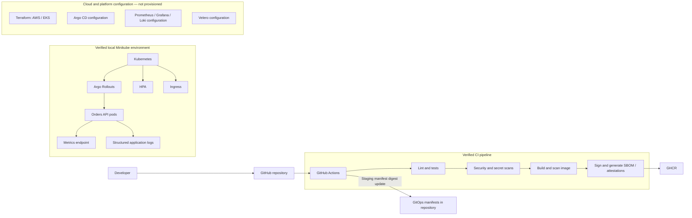

# End-to-End DevOps Platform — Orders API

A DevOps capstone built around a small FastAPI Orders API. The project demonstrates containerization, automated CI, security checks, Kubernetes deployment configuration, progressive delivery, GitOps manifest updates, observability configuration and infrastructure-as-code.

> **Verified deployment:** The application was deployed and tested on a local Minikube cluster. The GitHub Actions pipeline has passed, including testing, security checks, image build/scan and a staging GitOps manifest update. Hosted staging and AWS production infrastructure were not provisioned as part of the verified run.

## Architecture

The diagram distinguishes the pipeline and deployment configuration in the repository from the local Kubernetes environment that was actually verified.



## Project components

| Area | Implementation | Status / location |
|---|---|---|
| Application | FastAPI Orders API: health, readiness, version, order endpoints and metrics | Implemented — `app/` |
| Containerization | Multi-stage Docker build, slim base image, non-root user | Built and tested — `app/Dockerfile` |
| CI | GitHub Actions workflow with linting, tests and build | Passed — `.github/workflows/` |
| Security checks | Bandit, Gitleaks, Trivy and related workflow checks | CI checks verified — `.github/workflows/` |
| Supply-chain security | Image signing, SBOM and attestations | Pipeline steps configured and run — CI workflow |
| Kubernetes | Deployment configuration using Kustomize, probes, services, HPA, PDB, ingress and NetworkPolicies | Local Minikube deployment verified — `k8s/` |
| Progressive delivery | Argo Rollouts with stable/canary services and canary steps | Rollout configuration and local rollout status verified — `k8s/base/rollout.yaml` and overlays |
| GitOps | Repository-based environment manifests and Argo CD configuration | Configuration included; hosted Argo CD sync not verified — `argocd/` and `k8s/overlays/` |
| Metrics and logging | Application metrics endpoint and structured logs; monitoring-stack configuration | API metrics and logs verified; live Prometheus/Grafana/Loki deployment not verified |
| Infrastructure as Code | Terraform configuration for AWS infrastructure and related components | Configuration and validation; AWS resources not provisioned — `terraform/` |
| Documentation and evidence | Runbooks, configuration and screenshots | `docs/` and `evidence/` |

## CI pipeline

The GitHub Actions pipeline includes the following stages:

1. Code linting and formatting checks.
2. Automated tests and coverage checks.
3. Bandit security analysis.
4. Gitleaks secret scanning.
5. Docker image build.
6. Trivy image scanning.
7. Local container smoke test.
8. Image push to GHCR.
9. Cosign signing.
10. SBOM and attestation generation.
11. Staging GitOps manifest digest update.

The latest verified workflow run passed. The staging job updates the staging manifest in Git; it does **not** mean a live hosted staging environment was deployed or verified.

## Local Kubernetes deployment

The verified environment is **Minikube** running locally. The local Kustomize overlay was applied successfully and the following were verified:

- Orders API pods running and ready.
- Argo Rollout with two available replicas.
- Stable and canary Services.
- HPA metrics.
- Ingress access to the API.
- Application logs and metrics endpoint.
- Local, staging and production Kustomize overlays render successfully.

Useful verification commands:

```bash
kubectl apply -k k8s/overlays/local
kubectl get pods -n shop-local
kubectl get rollout -n shop-local
kubectl get hpa -n shop-local
kubectl get services -n shop-local
```

The repository also contains kind-oriented helper scripts. Those scripts are separate from the Minikube deployment that was used for the verified local run.

## Environment overlays

Kustomize overlays are provided for:

- `local`
- `staging`
- `prod`

All three overlays were successfully rendered with `kubectl kustomize`. The staging and production overlays are configuration examples for deployment environments; hosted staging and production were not provisioned or verified.

## Infrastructure as Code

Terraform files describe AWS infrastructure, including EKS and supporting resources. Terraform formatting and validation were performed.

**No AWS infrastructure was provisioned as part of the verified project deployment.** Cloud deployment requires reviewing and supplying the required variables, credentials, state backend, permissions and environment-specific values before running provisioning commands.

## Security

Security-related implementation and configuration includes:

- Non-root container execution.
- Bandit code security checks.
- Gitleaks secret scanning.
- Trivy image scanning.
- Kubernetes NetworkPolicy configuration.
- CI image signing and SBOM/attestation steps.
- Security-related Kubernetes and infrastructure configuration.

These items represent the checks and configuration included in the repository and pipeline; they should not be interpreted as proof that every cloud-side policy or enforcement component is running in a live production environment.

## Repository evidence

Screenshots documenting the project are organized under `evidence/`:

- `01-repository`
- `02-application`
- `03-docker`
- `04-cicd`
- `05-kubernetes`
- `06-gitops-canary`
- `07-monitoring-logging`
- `08-security-terraform`

## Repository structure

```text
app/                  FastAPI application and Docker build
.github/workflows/    CI and automation workflows
k8s/                  Base manifests and environment overlays
argocd/                GitOps application configuration
terraform/              Infrastructure-as-code
scripts/                Automation and helper scripts
docs/                   Runbooks and project documentation
evidence/                Project screenshots
```

## Future improvements

- Provision a real AWS EKS environment and validate the cloud deployment end-to-end.
- Configure and verify hosted staging, then production promotion with environment approvals.
- Deploy and validate the Prometheus, Grafana and logging stack in a live cluster.
- Scope Terraform IAM permissions to least privilege and configure a remote state backend.
- Add persistent storage/database support and externalized secret management for a production application.
