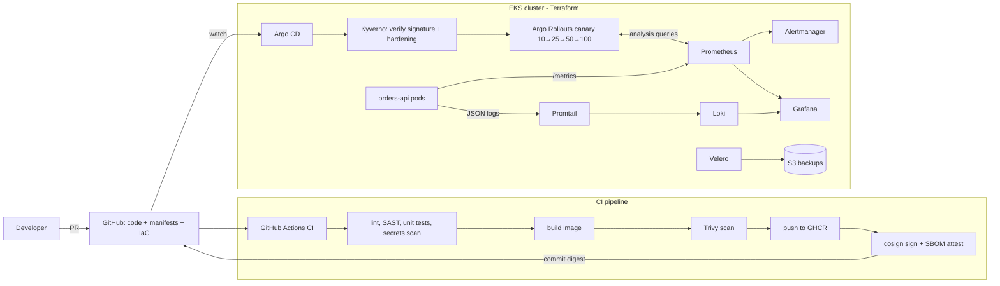

# End-to-End DevOps Platform: commit → production, with guardrails

A reproducible delivery platform for **orders-api** (a small FastAPI service). One `git push` drives
test → scan → build → sign → deploy to staging → verify → approve → **canary** to production, with
automatic rollback, observability, supply-chain security and backups built in.

## Architecture



| Concern | Implementation | Where |
|---|---|---|
| Version control | Trunk-based, PRs, CODEOWNERS, Dependabot, gitleaks; Git is the single source of truth (GitOps) | `.github/` |
| CI/CD | Test → SAST → build → Trivy gate → push → keyless cosign + SBOM → staging → smoke test → **manual approval** → prod | `.github/workflows/ci.yml` |
| Containerization | Multi-stage, non-root (uid 10001), read-only FS compatible, pinned deps | `app/Dockerfile` |
| Orchestration | Kustomize base + `local`/`staging`/`prod` overlays; HPA, PDB, topology spread, probes, preStop drain | `k8s/` |
| Infra automation | Terraform: VPC (3 AZ, flow logs), EKS (KMS secrets, IMDSv2, NetworkPolicy), Velero bucket + IRSA; remote state w/ locking; plan on PR, gated apply | `terraform/` |
| GitOps | Argo CD app-of-apps, sync waves, ApplicationSet per environment, self-heal + prune | `argocd/` |
| Monitoring | kube-prometheus-stack, ServiceMonitor, SLO burn-rate alerts, Grafana dashboard | `k8s/base/monitoring`, `argocd/apps/platform-monitoring.yaml` |
| Logging | Structured JSON logs → Promtail → Loki, queryable in Grafana next to metrics | `argocd/apps/platform-logging.yaml` |
| Security | Image signature enforcement, non-root/limits/registry/no-`latest` policies, Pod Security `restricted`, default-deny NetworkPolicy, OIDC (no long-lived cloud keys), CodeQL, dependency review, scheduled re-scans | `policies/`, `.github/workflows/security.yml` |
| Advanced deployment | **Canary with metric-gated promotion** (success rate ≥ 99 %, p95 ≤ 500 ms) and automatic abort/rollback via NGINX traffic splitting | `k8s/base/rollout.yaml`, `analysis-template.yaml` |
| Recoverability | Argo Rollouts undo, Git revert, Velero schedules, versioned/locked Terraform state, DR drill script | `scripts/rollback.sh`, `scripts/dr-drill.sh`, `docs/RUNBOOK.md` |

## The delivery flow

1. PR → lint, bandit, tests (≥80 % coverage), gitleaks, CodeQL, dependency review, k8s/Terraform validation.
2. Merge to `main` → image built, **Trivy blocks fixable HIGH/CRITICAL**, pushed, signed (keyless, OIDC identity of this workflow), SBOM attested.
3. CI commits the image **digest** to `k8s/overlays/staging` → Argo CD syncs → Kyverno verifies the signature → staging canary.
4. `verify-staging` polls `/version` until the new SHA serves, then runs a functional smoke test.
5. `promote-production` waits for **required reviewers**, then commits the same digest to `k8s/overlays/prod`.
6. Argo CD syncs prod; Argo Rollouts shifts 10 → 25 → 50 → 100 %, continuously querying Prometheus. A failed metric aborts and returns 100 % of traffic to the stable version, with no human needed.

The same digest is promoted through every environment, so what was tested is exactly what runs.

## Try it locally (kind, ~5 min)

Prereqs: docker, kind, kubectl, helm, [kubectl-argo-rollouts](https://argo-rollouts.readthedocs.io).

```bash
make test               # unit tests + coverage gate
make local-up           # kind + ingress + Argo Rollouts + Prometheus/Grafana + app
curl -H 'Host: orders.localtest.me' localhost:8080/version
make demo-good          # healthy release  → promoted step by step
make demo-bad           # 30 % injected 5xx → analysis fails → AUTOMATIC ROLLBACK
kubectl argo rollouts get rollout orders-api -n shop-local -w
```

## Deploy to AWS

1. `cd terraform/bootstrap && terraform init && terraform apply -var github_repo=OWNER/REPO` (state bucket, lock table, GitHub OIDC role).
2. Put the outputs into `terraform/versions.tf` (bucket) and GitHub secrets/vars: `AWS_TERRAFORM_ROLE_ARN`, `AWS_REGION`, `STAGING_URL`.
3. Edit `terraform/envs/prod.tfvars` (`api_allowed_cidrs`), then merge: the `terraform` workflow plans, waits for approval, applies.
4. `make bootstrap` installs Argo CD and the root app; everything else (ingress, cert-manager, Prometheus, Loki, Kyverno, Velero, the app) is reconciled from Git.
5. Replace placeholders: `OWNER/REPO` everywhere, `REPLACE_VELERO_BUCKET` / `REPLACE_VELERO_ROLE_ARN` (Terraform outputs), hosts in overlays, a `letsencrypt-prod` ClusterIssuer.
6. GitHub settings: create environments `staging`, `production` (required reviewers), `infra-prod`; protect `main` and let the delivery bot push manifest commits (or swap in a GitHub App token).

## Known limitations (what to harden next)

- The sample app is stateless and in-memory by design; a real service would add a database (managed RDS + backups) and an External Secrets Operator integration for credentials.
- The Terraform CI role is `AdministratorAccess` (marked TODO); scope it once the resource set is stable.
- Alertmanager receivers are placeholders; connect PagerDuty/Slack.
- Egress NetworkPolicies are not defined (ingress is default-deny); add them per workload.
- Chart/action versions are pinned but should be kept fresh via Renovate/Dependabot.
